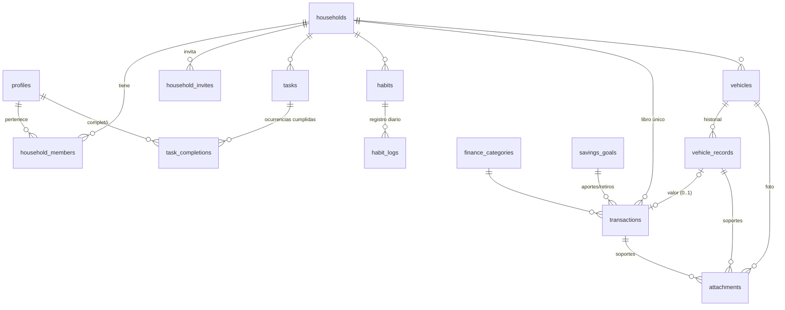

# Nido: propuesta de producto, arquitectura y plan

> Estado: **propuesta para aprobar**. Todavía no hay código de la app.
> Contexto de producto: [PRODUCT.md](../PRODUCT.md).
> Esquema SQL completo con RLS: [supabase/migrations/20261109000000_mvp.sql](../supabase/migrations/20261109000000_mvp.sql).

**Punto de partida:** el proyecto es nuevo. No hay código previo que integrar, así que todos los módulos son de creación y no hay nada que migrar.

---

## 0. Decisiones tomadas

| Tema | Decisión |
|---|---|
| App | Expo + React Native + TypeScript, Expo Router (rutas por archivos) |
| Backend | Supabase: Auth (email + contraseña), Postgres, RLS, Realtime, Storage |
| Datos en el cliente | TanStack Query con caché persistida: muestra lo último cargado sin señal. No es offline-first |
| Formularios | react-hook-form + zod (los mismos esquemas validan en el cliente) |
| Animación | Reanimated + Gesture Handler + expo-haptics |
| Recurrencias | Formato estándar RRULE (`FREQ=WEEKLY;BYDAY=MO,TH`) con la librería `rrule` |
| Fechas y dinero | date-fns con zona `America/Bogota`. Montos `numeric(14,2)` en COP, formateados con `Intl` |
| Desktop futuro | Expo web empaquetado con Tauri. El layout se adapta por ancho: barra inferior en el celular, riel lateral desde 600dp |
| Plataforma de diseño | Android con Material 3 como estructura (barra de navegación, FAB, bottom sheets, snackbars). La identidad de Nido se expresa con tema propio: color, tipografía, forma y movimiento |

---

## 1. Estructura de la app y sus módulos

```
nido/
├─ app/                          # Expo Router: solo pantallas y layouts
│  ├─ (auth)/                    # entrar, crear cuenta
│  ├─ (onboarding)/              # crear hogar · unirse con código
│  ├─ (app)/
│  │  ├─ (tabs)/
│  │  │  ├─ index.tsx            # Hoy
│  │  │  ├─ tareas.tsx
│  │  │  ├─ habitos.tsx
│  │  │  ├─ dinero.tsx
│  │  │  └─ garaje.tsx
│  │  ├─ tareas/[id].tsx         # detalle + historial
│  │  ├─ habitos/[id].tsx        # racha, calendario, estadísticas
│  │  ├─ dinero/metas/[id].tsx
│  │  ├─ garaje/[id].tsx         # perfil del vehículo
│  │  ├─ garaje/[id]/registro/[recordId].tsx
│  │  └─ hogar.tsx               # integrantes, invitar, preferencias
├─ src/
│  ├─ features/                  # un módulo por dominio, misma forma en todos
│  │  ├─ household/   { api.ts, hooks.ts, schema.ts, components/ }
│  │  ├─ tasks/
│  │  ├─ habits/
│  │  ├─ finance/
│  │  ├─ vehicles/
│  │  ├─ qr/                     # fase 6
│  │  └─ notifications/          # fase 7
│  ├─ ui/                        # sistema de diseño de Nido
│  │  ├─ tokens.ts               # color, tipo, espacio, forma, movimiento
│  │  ├─ primitives/             # Text, Button, Card, Sheet, Field, Chip, Avatar…
│  │  └─ motion/                 # presets, useReducedMotion, celebraciones
│  └─ lib/
│     ├─ supabase.ts             # cliente + tipos generados (supabase gen types)
│     ├─ query.ts                # QueryClient, persistencia, realtime → invalidación
│     ├─ recurrence.ts           # ocurrencias de tareas a partir de RRULE
│     ├─ money.ts · dates.ts
└─ supabase/
   ├─ migrations/                # una migración por fase
   ├─ seed.sql                   # datos sintéticos para desarrollo
   └─ functions/                 # Edge Functions (notificaciones, fase 7)
```

**Regla de organización:** cada módulo de `features/` expone hooks (`useTasks`, `useCompleteTask`…) y las pantallas solo consumen hooks. Ningún módulo consulta tablas de otro directamente. Cuando hay cruce, como un gasto de vehículo que crea un movimiento, lo resuelve una función de la base de datos y no el cliente.

---

## 2. Arquitectura de datos

### 2.1 Modelo de visibilidad (la pieza central)

Todas las tablas de dominio (tareas, hábitos, movimientos, metas, vehículos) llevan las mismas tres columnas:

| Columna | Significado |
|---|---|
| `household_id` | Hogar al que pertenece |
| `owner_id` | Quién lo creó o a quién pertenece |
| `visibility` | `personal`: solo el dueño · `shared`: todo el hogar |

Con eso, **una sola regla** decide quién ve qué: `can_see(hogar, dueño, visibilidad)`. Agregar un tercer integrante no cambia nada: el hogar simplemente tiene una fila más en `household_members`.

### 2.2 Relaciones



### 2.3 Tres decisiones de modelado que importan

**1. Las tareas recurrentes no se "reinician": cada ocurrencia es nueva.**
La tarea guarda su regla (`recurrence = 'FREQ=DAILY'`). Cada vez que alguien la cumple se crea una fila en `task_completions` con `occurrence_on` (el día o la semana que cumplió). Que "lavar platos" esté pendiente hoy significa que no existe un cumplimiento para la ocurrencia de hoy. Ventajas:
- No hace falta un cron que resetee nada.
- El historial de quién la hizo y cuándo sale gratis.
- `UNIQUE (task_id, occurrence_on)` impide los duplicados, también cuando más adelante se complete por QR.

**2. El dinero vive en un solo lugar.**
`transactions` es el libro único de movimientos. Un mantenimiento (`vehicle_records`) no guarda el valor, solo apunta a su movimiento (`transaction_id`). Registrar un cambio de aceite de $180.000 llama a `create_vehicle_expense(...)`, que en una sola operación atómica crea el movimiento (categoría *Vehículos*) y el registro del vehículo. Así aparece en el historial de la moto **y** en las finanzas del hogar sin duplicarse. Si se borra el movimiento, el registro del mantenimiento sigue existiendo (el kilometraje y la fecha siguen siendo útiles), solo pierde el valor.

**3. Los ahorros también son movimientos.**
Un aporte a una meta es un movimiento `kind = 'saving'` con `goal_id`; un retiro es el mismo tipo con valor negativo. El progreso de la meta es una suma. No hay saldos guardados que se puedan desincronizar.

### 2.4 Valores calculados (no se guardan)

| Dato | De dónde sale |
|---|---|
| Tareas pendientes de hoy | Ocurrencias de hoy (RRULE) menos `task_completions` |
| Racha de un hábito | Días consecutivos con `habit_logs.amount >= target_count` |
| Balance del mes | Suma de `transactions` por `kind` en el rango |
| Ahorrado por meta | Suma de `transactions` con ese `goal_id` |
| Gasto por vehículo y categoría | `vehicle_records` unido con `transactions` |
| Kilometraje actual | `vehicles.odometer_km`, que un trigger sube con cada registro de mayor kilometraje |

En el MVP estos cálculos se hacen en el cliente sobre datos ya filtrados por RLS. Cuando los reportes crezcan (fase 9) se pasan a vistas o funciones SQL.

---

## 3. Tablas en Supabase (MVP)

El detalle completo (tipos, restricciones, índices y triggers) está en la migración. Resumen:

| Tabla | Para qué | Claves |
|---|---|---|
| `profiles` | Nombre, avatar y color personal de cada usuario | Se crea sola al registrarse (trigger) |
| `households` | El hogar: nombre, moneda, zona horaria | Se crea con `create_household()` |
| `household_members` | Quién pertenece y con qué rol (`owner`/`member`) | PK (hogar, usuario) |
| `household_invites` | Código de 8 caracteres, un solo uso, vence en 7 días | Se usa con `join_household()` |
| `tasks` | Tarea: asignado (o compartida), prioridad, fecha, hora, RRULE | Si es personal, solo puede estar asignada a su dueño |
| `task_completions` | Cada ocurrencia cumplida, por quién y cuándo, origen manual/QR | UNIQUE (tarea, ocurrencia) |
| `habits` | Hábito: meta por período, días de la semana, unidad, recordatorio | Personal por defecto |
| `habit_logs` | Registro diario | UNIQUE (hábito, día) |
| `finance_categories` | Categorías del sistema + propias del hogar | 17 categorías iniciales |
| `savings_goals` | Metas de ahorro personales o compartidas | |
| `transactions` | **Libro único**: ingresos, gastos y ahorros | Ingresos y gastos siempre > 0 |
| `vehicles` | Perfil: apodo, moto/carro, marca, modelo, año, placa, km, fecha de compra | Placa única por hogar |
| `vehicle_records` | Historial: tipo, concepto, km, fecha, notas → movimiento opcional | 12 tipos (aceite, llantas, SOAT…) |
| `attachments` | Fotos y soportes de vehículos, registros o movimientos | Archivo en el bucket privado `media` |

---

## 4. Permisos y seguridad (RLS)

**Principio:** la privacidad la garantiza la base de datos, no la interfaz. Aunque alguien modifique la app, Postgres no le devuelve lo que no puede ver.

| Recurso | Ver | Crear | Editar | Borrar |
|---|---|---|---|---|
| Perfil | El propio y los de mi hogar | Automático | Solo el propio | — |
| Hogar | Si soy miembro | Vía `create_household` | Rol owner | Rol owner |
| Integrantes | Los de mi hogar | Vía `join_household` | — | Salirme yo, o el owner |
| Tarea / hábito / meta / movimiento / vehículo | Compartidos del hogar + mis personales | En mi hogar, a mi nombre | Lo que puedo ver | Solo el autor (los demás archivan) |
| Cumplimiento de tarea | Si veo la tarea | Si veo la tarea, firmado por mí | — | Solo quien la cumplió (deshacer) |
| Registro de hábito | Si veo el hábito | Solo el dueño del hábito | Solo el dueño | Solo el dueño |
| Registro de vehículo | Si veo el vehículo | Si veo el vehículo | Si veo el vehículo | Solo el autor |
| Adjunto / archivo | Si veo el registro al que pertenece | En mi carpeta `{hogar}/{yo}/` | — | Solo el autor |

Detalles de seguridad:
- Los helpers (`is_member`, `can_see`…) son `SECURITY DEFINER` con `search_path` vacío. Así se evita la recursión de RLS y la inyección por `search_path`.
- Un trigger impide que un `UPDATE` cambie `owner_id` o `household_id`. Nadie puede "adueñarse" de un registro ni moverlo de hogar.
- El asignado de una tarea debe pertenecer al hogar (trigger).
- `create_vehicle_expense` es `SECURITY INVOKER`: corre con los permisos del usuario, así que la RLS aplica también dentro de la función.
- **Caso borde a propósito:** si registro con valor personal un gasto de un vehículo compartido, mi pareja ve el mantenimiento (fecha, km, concepto) pero no el valor.
- Realtime respeta RLS: cada celular solo recibe los cambios que puede leer.

---

## 5. Navegación y experiencia de usuario

### 5.1 Estructura

Barra de navegación inferior (Material 3) con cinco destinos. En pantallas anchas (desktop o tablet) se convierte en riel lateral.

| Destino | Qué responde | Acción principal (FAB) |
|---|---|---|
| **Hoy** | ¿Qué falta hoy y qué pasó en la casa? | Agregar rápido: tarea, gasto, ingreso, hábito o gasto de vehículo |
| **Tareas** | ¿Qué tengo yo, qué tiene ella, qué es de los dos? | Nueva tarea |
| **Hábitos** | ¿Cómo voy con lo mío? | Nuevo hábito |
| **Dinero** | ¿Cuánto entró, salió y ahorramos? | Registrar movimiento |
| **Garaje** | ¿Cómo están los vehículos y qué se viene? | Registrar gasto del vehículo |

- **Hogar y perfil:** avatar en la barra superior → integrantes, invitar con código, preferencias.
- **Escáner QR (fase 6):** ícono en la barra superior de *Hoy*.
- **Botón Atrás del sistema:** siempre funciona y cierra hojas antes de navegar.

### 5.2 Pantallas clave

**Hoy**, el tablero que hace que Nido no parezca un gestor genérico:
1. Encabezado con fecha y estado del día ("3 de 7 cosas hechas").
2. **Lo de hoy:** tareas de hoy (mías + compartidas), cada una firmada con el avatar y color de quien le toca. Se completa con un toque.
3. **Mis hábitos de hoy:** anillos de progreso; un toque suma.
4. **La casa:** actividad reciente de la pareja ("completó *Sacar la basura* · 8:12 p. m.").
5. **El mes:** gastado vs. mes anterior y la meta de ahorro principal.
6. **Se viene:** próximos vencimientos (SOAT, tecnomecánica, aceite) cuando existan.

**Tareas:** filtro segmentado *Mías · Compartidas · Todas* y agrupación *Atrasadas · Hoy · Próximas · Sin fecha*. El detalle muestra la recurrencia y el historial (quién y cuándo).

**Hábitos:** lista con anillo del día. El detalle trae racha actual y récord, calendario de cumplimiento y porcentaje por semana y mes.

**Dinero:** selector *Hogar / Personal*, balance del período (ingresos, gastos, ahorro) y pestañas *Movimientos · Metas · Reportes*. Los movimientos se agrupan por día y muestran quién los registró.

**Garaje:** una tarjeta por vehículo con foto, km y gasto del año. El perfil incluye historial filtrable por tipo, total gastado, gasto por categoría y *Próximos* (fase 8).

**Registro rápido:** la acción más frecuente (anotar un gasto) se hace en una hoja inferior con el teclado numérico ya abierto. Valor, categoría y listo; lo demás es opcional. Meta: **menos de 5 segundos**.

### 5.3 Principios de movimiento

| Momento | Comportamiento |
|---|---|
| Completar tarea | El check se dibuja, la fila se asienta y vibra suave; si la tarea es compartida, el avatar de quien la hizo "firma" la fila |
| Registrar gasto | La hoja se cierra y el total del mes se actualiza con un conteo corto hasta el nuevo valor |
| Hábitos y metas | Los anillos y barras se llenan animados hasta el valor real; al cerrar el día o la meta hay una celebración discreta |
| Navegación | Transiciones de eje compartido entre pestañas; de tarjeta a detalle con transformación de contenedor (con fundido simple como respaldo) |
| Carga | Esqueletos con la forma del contenido real, nunca pantallas en blanco; los datos en caché se muestran al instante y se refrescan detrás |
| Reglas | 150–250 ms, curvas de Material, solo `transform` y `opacity`. Con "quitar animaciones" activado en Android: fundidos o cortes instantáneos |

### 5.4 Identidad visual: "Línea de metro" (elegida)

El día del hogar es un **diagrama de líneas**: cada integrante es una línea de color, lo compartido es el tronco donde se unen y cada tarea es una estación que se llena al cumplirse. El contrato completo está en `.impeccable/surfaces/app-app-tabs-index-tsx.md`.

- **Colores:** fondo blanco de señalética `#F6F7F7`, tinta `#15171A`. Cada persona elige su color de línea (naranja, verde azulado, magenta, ámbar o verde) y el tronco compartido es azul `#3B5BDB`.
- **Estados de estación:** anillo = pendiente, llena = hecha, marca roja = atrasada, tachada = saltada. Es el mismo vocabulario en todos los módulos.
- **Tipografía:** Schibsted Grotesk para rótulos de línea y cifras tabulares, Roboto para el cuerpo.
- **Movimiento firma:** al completar, la estación se llena desde el centro y el tramo hacia la siguiente se colorea hacia adelante, con vibración suave.
- **Alcance en otros módulos:**
  - **Hábitos:** una línea circular de la semana.
  - **Vehículos:** una línea de kilometraje con el próximo mantenimiento como siguiente estación.
  - **Finanzas:** cada movimiento va firmado con el color de línea de quien lo registró.
- Estructura Material 3 en Android; modo oscuro como esquema de primera clase.

---

## 6. Plan de implementación por etapas

Cada fase termina con algo usable en tu celular (Expo Go o APK) y su migración aplicada.

| Fase | Entrega | Listo cuando… |
|---|---|---|
| **0. Fundaciones** | Proyecto Expo, proyecto Supabase, migración MVP, login, crear/unirse a hogar, sistema de diseño base, dirección visual elegida | Tú y tu esposa entran desde sus celulares y quedan en el mismo hogar |
| **1. Tareas** | CRUD, asignación, personales/compartidas, prioridades, recurrencia, completar/deshacer, historial, realtime | Una tarea que completa uno aparece hecha en el celular del otro en segundos |
| **2. Hábitos** | CRUD, registro diario, rachas, calendario, estadísticas | Una semana de uso real muestra racha y porcentaje correctos |
| **3. Finanzas** | Movimientos, categorías, Hogar/Personal, metas de ahorro, balance y reporte mensual/anual | Un mes registrado cuadra con lo que gastaron de verdad |
| **4. Vehículos** | Perfiles, foto, historial, gasto vinculado a finanzas, totales por vehículo y categoría | El cambio de aceite aparece en la moto y en Dinero una sola vez |
| **5. Hoy** | Tablero completo con datos reales de los 4 módulos + pulido de movimiento | *Hoy* responde "qué falta y qué pasó" sin entrar a otra pestaña |
| — | **MVP: APK instalada en ambos celulares** | |
| **6. QR** | Generar e imprimir QR por tarea/espacio, escanear y completar | Escanear el QR del lavaplatos completa la tarea de hoy; escanear dos veces no duplica |
| **7. Notificaciones** | Recordatorios locales, push cuando la pareja completa algo, preferencias por usuario | Cada uno controla qué le llega y a qué hora |
| **8. Mantenimientos** | Programación por km o fecha, alertas de SOAT y tecnomecánica | Nido avisa antes del vencimiento sin que nadie lo consulte |
| **9. Reportes y desktop** | Comparativas, evolución, exportar; build web/desktop | Reportes anuales y Nido abierto en el PC |

---

## 7. Lo que queda preparado (fases 6 a 9)

La estructura del MVP ya soporta estas fases sin rehacer nada. Solo se agregan tablas:

```sql
-- Fase 6 · QR: el código impreso lleva solo un token aleatorio, nunca IDs.
qr_tags (id, household_id, task_id → tasks, label, place, token unique, active, created_by)
-- RPC complete_task_by_qr(token): valida membresía, que el QR esté activo, la ocurrencia de hoy
-- y la ventana de tiempo, e inserta en task_completions con source = 'qr' (UNIQUE evita duplicados).

-- Fase 7 · Notificaciones
device_tokens (user_id, expo_push_token unique, platform, last_seen_at)
notification_prefs (user_id, kind, enabled, lead_minutes, quiet_from, quiet_to)
-- Recordatorios de tareas y hábitos: notificaciones locales programadas en el celular.
-- "Tu pareja completó…": Database Webhook en task_completions → Edge Function → Expo Push.
-- Vencimientos: pg_cron diario → Edge Function.

-- Fase 8 · Mantenimientos
maintenance_plans (id, vehicle_id, type, every_km, every_months,
                   next_due_km, next_due_on, notify_before_km, notify_before_days, last_record_id)
-- Al crear un vehicle_record de ese tipo, un trigger recalcula next_due_km / next_due_on.
-- SOAT y tecnomecánica son planes con every_months = 12 y solo fecha.
```

---

## 8. Qué necesito de ti para la fase 0

1. **Crear un proyecto en [supabase.com](https://supabase.com)** (plan gratis) y pasarme la *Project URL* y la *anon key*. La anon key es pública por diseño; la seguridad está en la RLS.
2. **Node.js 20+** en tu PC.
3. **Expo Go** instalado en tu celular Android.
4. **Elegir la dirección visual** en la ronda de propuestas.

## 9. Decisiones abiertas (tienen valor por defecto, se pueden cambiar)

- **Borrar lo compartido:** hoy solo el autor puede borrar; el otro integrante archiva. ¿Les sirve así?
- **Hábitos visibles para la pareja:** por defecto son privados. ¿Quieren poder compartir alguno, por ejemplo "ir al gimnasio juntos"?
- **Moneda:** solo COP en el MVP. ¿Manejan otra?
